# CineFlow: UML Class Diagram & Architecture
**Project**: CineFlow - Cinema Production Management System  
**Level**: 2nd-Year College Object-Oriented Programming (Java) Mini-Project  

---

## 1. Visual Mermaid Class Diagram

```mermaid
classDiagram
    direction TB

    %% Custom Exception Hierarchy (Inheritance)
    class Exception {
        <<external>>
    }

    class CineFlowException {
        +CineFlowException(message: String)
        +CineFlowException(message: String, cause: Throwable)
    }

    class BudgetExceededException {
        -double attemptedAmount
        -double remainingBudget
        -double totalBudget
        +BudgetExceededException(message: String)
        +BudgetExceededException(attemptedAmount, remainingBudget, totalBudget)
        +getAttemptedAmount() double
        +getRemainingBudget() double
        +getTotalBudget() double
    }

    class ResourceNotFoundException {
        -String resourceType
        -String resourceId
        +ResourceNotFoundException(message: String)
        +ResourceNotFoundException(resourceType, resourceId)
        +getResourceType() String
        +getResourceId() String
    }

    class ScheduleConflictException {
        -String locationOrEntity
        -String conflictDate
        -String reason
        +ScheduleConflictException(message: String)
        +ScheduleConflictException(locationOrEntity, conflictDate, reason)
        +getLocationOrEntity() String
        +getConflictDate() String
        +getReason() String
    }

    class ValidationException {
        -String fieldName
        +ValidationException(message: String)
        +ValidationException(fieldName, message)
        +getFieldName() String
    }

    Exception <|-- CineFlowException : Extends
    CineFlowException <|-- BudgetExceededException : Inheritance
    CineFlowException <|-- ResourceNotFoundException : Inheritance
    CineFlowException <|-- ScheduleConflictException : Inheritance
    CineFlowException <|-- ValidationException : Inheritance

    %% Abstract Base Class & Subclasses (Inheritance & Polymorphism)
    class Person {
        <<abstract>>
        -String id
        -String name
        -String email
        +Person(id, name, email)
        +getId() String
        +setId(id) void
        +getName() String
        +setName(name) void
        +getEmail() String
        +setEmail(email) void
        +getRole()* String
        +displayInfo() void
        +toString() String
    }

    class Actor {
        -String characterName
        +Actor(id, name, email, characterName)
        +getCharacterName() String
        +setCharacterName(characterName) void
        +getRole() String
    }

    class CrewMember {
        -String department
        +CrewMember(id, name, email, department)
        +getDepartment() String
        +setDepartment(department) void
        +getRole() String
    }

    Person <|-- Actor : Inheritance
    Person <|-- CrewMember : Inheritance

    %% Lifecycle Enum
    class MovieStatus {
        <<enumeration>>
        PLANNING
        PRODUCTION
        POST_PRODUCTION
        RELEASED
    }

    %% Review Entity
    class Review {
        -String reviewerName
        -int rating
        -String comment
        +Review(reviewerName, rating, comment)
        +getReviewerName() String
        +setReviewerName(name) void
        +getRating() int
        +setRating(rating) void
        +getComment() String
        +setComment(comment) void
        +toString() String
    }

    %% Core Domain Entities
    class Scene {
        -int sceneNumber
        -String title
        -String location
        -String status
        -String shootingDate
        +Scene(sceneNumber, title, location, status)
        +Scene(sceneNumber, title, location, status, shootingDate)
        +getSceneNumber() int
        +setSceneNumber(number) void
        +getTitle() String
        +setTitle(title) void
        +getLocation() String
        +setLocation(loc) void
        +getStatus() String
        +setStatus(status) void
        +getShootingDate() String
        +setShootingDate(date) void
        +toString() String
    }

    class Expense {
        -String id
        -String category
        -double amount
        -String description
        +Expense(id, category, amount, description)
        +getId() String
        +setId(id) void
        +getCategory() String
        +setCategory(category) void
        +getAmount() double
        +setAmount(amount) void
        +getDescription() String
        +setDescription(desc) void
        +toString() String
    }

    class Movie {
        -String id
        -String title
        -String genre
        -String director
        -int releaseYear
        -double budget
        -MovieStatus status
        -List~Scene~ scenes
        -List~Person~ castAndCrew
        -List~Expense~ expenses
        -List~Review~ reviews
        +Movie(id, title, genre, director, year, budget)
        +Movie(id, title, genre, director, year, budget, status)
        +getId() String
        +getTitle() String
        +getGenre() String
        +getDirector() String
        +getReleaseYear() int
        +getBudget() double
        +getStatus() MovieStatus
        +setStatus(status) void
        +getScenes() List~Scene~
        +getCastAndCrew() List~Person~
        +getExpenses() List~Expense~
        +getReviews() List~Review~
        +addScene(Scene) void
        +scheduleScene(sceneNumber, shootingDate) void
        +findSceneByNumber(sceneNumber) Scene
        +getSceneOrThrow(sceneNumber) Scene
        +addPerson(Person) void
        +removePerson(personId) boolean
        +findPersonById(personId) Person
        +addExpense(Expense) void
        +addReview(Review) void
        +getAverageRating() double
        +getTotalExpenses() double
        +getRemainingBudget() double
        +getBudgetUtilizationPercentage() double
        +toString() String
    }

    class ProductionHouse {
        -String id
        -String name
        -String headquarters
        -List~Movie~ movies
        +ProductionHouse(id, name, headquarters)
        +getId() String
        +getName() String
        +getHeadquarters() String
        +getMovies() List~Movie~
        +addMovie(Movie) void
        +findMovieById(id) Movie
        +getMovieOrThrow(id) Movie
        +toString() String
    }

    %% Service & Management Classes
    class CastManager {
        +CastManager()
        +addPerson(Movie, Person) void
        +addActor(Movie, Actor) void
        +addCrewMember(Movie, CrewMember) void
        +removePersonById(Movie, personId) boolean
        +findPersonById(Movie, personId) Person
        +searchPersonnel(Movie, query) List~Person~
        +getActors(Movie) List~Actor~
        +getCrewMembers(Movie) List~CrewMember~
        +getAllPersonnel(Movie) List~Person~
    }

    class ReviewManager {
        +ReviewManager()
        +addReview(Movie, Review) void
        +calculateAverageRating(Movie) double
        +getRatingDistribution(Movie) Map~Integer, Integer~
        +filterMoviesByMinRating(movies, minRating) List~Movie~
        +getReviews(Movie) List~Review~
        +getTotalReviewCount(Movie) int
    }

    class FileService {
        -String dataDir
        +FileService()
        +FileService(dataDir: String)
        +saveAllData(studios: List~ProductionHouse~) void
        +loadAllData() List~ProductionHouse~
        +hasExistingData() boolean
    }

    class MovieManager {
        -Map~String, ProductionHouse~ studios
        -FileService fileService
        -CastManager castManager
        -ReviewManager reviewManager
        -String activeStudioId
        -String activeMovieId
        +MovieManager()
        +addStudio(ProductionHouse) void
        +getStudio(id: String) ProductionHouse
        +getStudioOrThrow(id: String) ProductionHouse
        +getAllStudios() List~ProductionHouse~
        +getAllMovies() List~Movie~
        +getActiveStudio() ProductionHouse
        +setActiveStudioId(id: String) void
        +getActiveMovie() Movie
        +setActiveMovieId(id: String) void
        +addMovieToActiveStudio(Movie) void
        +findMovieAnywhere(id: String) Movie
        +findMovieOrThrow(id: String) Movie
        +searchMovies(query, genre, minRating) List~Movie~
        +getCastManager() CastManager
        +getReviewManager() ReviewManager
        +saveData() void
        +loadData() void
        +seedInitialData() void
    }

    %% Presentation / CLI
    class ConsoleMenu {
        -MovieManager manager
        -CastManager castManager
        -ReviewManager reviewManager
        -Scanner scanner
        +ConsoleMenu(manager: MovieManager)
        +ConsoleMenu(manager, castManager, reviewManager)
        +start() void
    }

    class Main {
        +main(args: String[]) void
    }

    %% Relationships
    Movie --> MovieStatus : Uses
    Movie *-- Review : Aggregation (1 to Many)
    ProductionHouse *-- Movie : Aggregation (1 to Many)
    Movie *-- Scene : Composition (1 to Many)
    Movie *-- Expense : Composition (1 to Many)
    Movie o-- Person : Polymorphic Association (1 to Many)
    
    Movie ..> BudgetExceededException : Throws on budget overrun
    Movie ..> ScheduleConflictException : Throws on date/location clash
    Movie ..> ValidationException : Throws on rule violations
    Movie ..> ResourceNotFoundException : Throws on missing scene/record

    CastManager ..> Movie : Operates on personnel roster
    CastManager ..> Person : Manages polymorphically
    CastManager ..> ResourceNotFoundException : Throws when member missing
    CastManager ..> ValidationException : Throws on duplicate/null

    ReviewManager ..> Movie : Validates lifecycle & calculates metrics
    ReviewManager ..> Review : Enforces 1-5 rating & status rules
    ReviewManager ..> ValidationException : Throws on unreleased/invalid

    MovieManager o-- ProductionHouse : Manages via HashMap
    MovieManager o-- FileService : Uses for Text File I/O
    MovieManager o-- CastManager : Uses for cast coordination
    MovieManager o-- ReviewManager : Uses for review filtering
    ConsoleMenu o-- MovieManager : Coordinates business services
    ConsoleMenu o-- CastManager : Delegates cast roster operations
    ConsoleMenu o-- ReviewManager : Delegates review operations
    ConsoleMenu ..> CineFlowException : Handles all custom exceptions
    Main ..> MovieManager : Initializes
    Main ..> ConsoleMenu : Launches
```

---

## 2. Summary of Key OOP Concepts Demonstrated

1. **Classes and Objects**: Separation of domain entities (`Movie`, `ProductionHouse`, `Scene`, `Expense`, `Review`, `Person`) and service managers (`MovieManager`, `CastManager`, `ReviewManager`, `FileService`).
2. **Encapsulation & Single Responsibility Principle (SRP)**:
   - `CastManager` manages personnel roster operations (add, remove, search, filter).
   - `ReviewManager` manages audience feedback, rating verification, and distribution analytics.
   - Private attributes with validated getters and setters across all entities.
3. **Inheritance & Abstraction**:
   - `Person` is an abstract base class extended by concrete subclasses `Actor` and `CrewMember`.
   - `CineFlowException` is an abstract base checked exception extended by four concrete specialized checked exceptions.
4. **Polymorphism & Dynamic Method Dispatch**:
   - `Actor` and `CrewMember` override `getRole()`.
   - In `Movie` and `CastManager`, `Person` references are handled polymorphically, and `instanceof` with downcasting is demonstrated in `getActors()` and `getCrewMembers()`.
5. **Enumerations**: `MovieStatus` encapsulates the 4 lifecycle states (`PLANNING`, `PRODUCTION`, `POST_PRODUCTION`, `RELEASED`).
6. **Custom Checked Exception Hierarchy**:
   - `CineFlowException extends Exception`
   - `BudgetExceededException extends CineFlowException`
   - `ResourceNotFoundException extends CineFlowException`
   - `ScheduleConflictException extends CineFlowException`
   - `ValidationException extends CineFlowException`
7. **Collections Framework**:
   - `ArrayList` for ordered dynamic collections (movies, scenes, personnel, expenses, reviews).
   - `HashMap` for $O(1)$ studio lookups by ID and frequency counting in `ReviewManager.getRatingDistribution()`.
8. **File Handling (Java I/O)**:
   - Human-readable pipe-delimited text files in `data/` using `BufferedReader`, `PrintWriter`, `FileReader`, and `FileWriter`.
   - Fault-tolerant parsing skips corrupted lines gracefully with logged warnings rather than terminating the application or silently wiping existing memory state.
