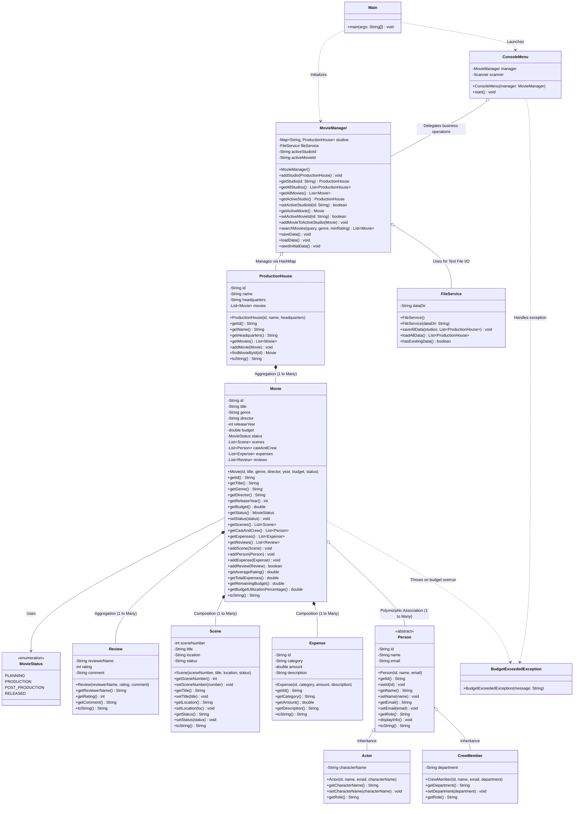

# CineFlow: UML Class Diagram & Architecture
**Project**: CineFlow - Cinema Production Management System  
**Level**: 2nd-Year College Object-Oriented Programming (Java) Mini-Project  

---

## 1. Visual Mermaid Class Diagram

---

## 2. Summary of Key OOP Concepts Demonstrated

1. **Classes and Objects**: Separation of domain entities (`Movie`, `ProductionHouse`, `Scene`, `Expense`, `Review`).
2. **Encapsulation**: Private fields accessed through getters/setters with validation logic (`addReview` checks `RELEASED` status and rating 1-5).
3. **Inheritance & Abstraction**: Base abstract class `Person` extended by `Actor` and `CrewMember`.
4. **Polymorphism & Method Overriding**: `Actor` and `CrewMember` override `getRole()`. In `Movie`, `List<Person>` stores both actors and crew polymorphically.
5. **Enumerations**: `MovieStatus` encapsulates lifecycle phases (`PLANNING`, `PRODUCTION`, `POST_PRODUCTION`, `RELEASED`).
6. **Collections Framework**:
   - `ArrayList` for movies, scenes, personnel, expenses, reviews.
   - `HashMap` in `MovieManager` for $O(1)$ key-value studio lookups by ID.
7. **Custom Exception Handling**: `BudgetExceededException` checked exception enforces budget ceilings.
8. **File Handling (I/O Streams)**: Human-readable text files in `data/` using `BufferedReader` and `PrintWriter` with pipe delimiters.
