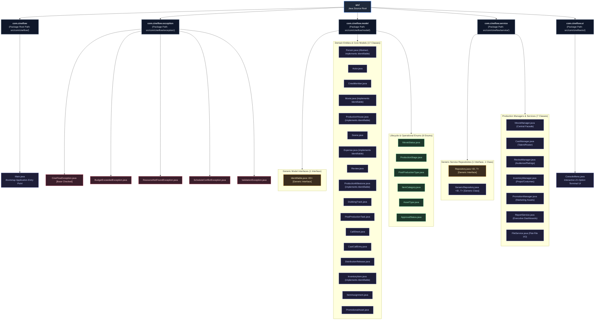

# CineFlow: UML Class Diagram & Architecture
**Project**: CineFlow - Cinema Production Management System  
**Level**: 2nd-Year College Object-Oriented Programming (Java) Mini-Project  
**Specifications**:
- **UML Class Diagram**: Contains **ALL 40 classes, generic interfaces, and enums** across the project.
- **Arrows**: Represents **ONLY inheritance & realization arrows** (`<|--` for class inheritance, `<|..` for interface realization). Zero arrows for delegation, association, composition, or dependency.
- **Package Path Diagram**: Presented separately to illustrate the repository directory structure, package paths, and constituent classes.

---

## 1. Visual Mermaid Class Diagram (All 40 Types: Classes, Generic Interfaces, & Enums)
> [!NOTE]
> Per specification, **only inheritance (`<|--`) and interface realization (`<|..`) relationships** are drawn with arrows. All standalone and delegating classes/enums are depicted with their attributes, constructors, and methods without delegation/association arrows.

```mermaid
classDiagram
    direction TB

    %% =========================================================================
    %% 1. GENERIC INTERFACES & REALIZATIONS (ONLY INHERITANCE / REALIZATION ARROWS)
    %% =========================================================================

    class Identifiable~ID~ {
        <<interface>>
        +getId()* ID
    }

    class Repository~ID, T~ {
        <<interface>>
        +add(entity: T)* void
        +findById(id: ID)* T
        +getOrThrow(id: ID)* T
        +getAll()* List~T~
        +remove(id: ID)* boolean
        +contains(id: ID)* boolean
        +size()* int
        +isEmpty()* boolean
        +clear()* void
        +filter(predicate: Predicate)* List~T~
    }

    class GenericRepository~ID, T~ {
        -Map~ID, T~ storage
        -String entityName
        +GenericRepository(entityName: String)
        +add(entity: T) void
        +findById(id: ID) T
        +getOrThrow(id: ID) T
        +getAll() List~T~
        +remove(id: ID) boolean
        +contains(id: ID) boolean
        +size() int
        +isEmpty() boolean
        +clear() void
        +filter(predicate: Predicate) List~T~
        +filterList(list: List~E~, predicate: Predicate)$ List~E~
        +findFirst(list: List~E~, predicate: Predicate)$ E
    }

    Repository <|.. GenericRepository : Implements

    %% =========================================================================
    %% 2. INHERITANCE HIERARCHIES (EXCEPTION & PERSONNEL HIERARCHIES)
    %% =========================================================================

    %% Exception Hierarchy (Inheritance: Exception -> CineFlowException -> Specialized Exceptions)
    class Exception {
        <<external>>
    }

    class CineFlowException {
        +CineFlowException(message: String)
        +CineFlowException(message: String, cause: Throwable)
    }

    class BudgetExceededException {
        -double attemptedAmount
        -double remainingBudget
        -double totalBudget
        +BudgetExceededException(message: String)
        +BudgetExceededException(attemptedAmount: double, remainingBudget: double, totalBudget: double)
        +getAttemptedAmount() double
        +getRemainingBudget() double
        +getTotalBudget() double
    }

    class ResourceNotFoundException {
        -String resourceType
        -String resourceId
        +ResourceNotFoundException(message: String)
        +ResourceNotFoundException(resourceType: String, resourceId: String)
        +getResourceType() String
        +getResourceId() String
    }

    class ScheduleConflictException {
        -String locationOrEntity
        -String conflictDate
        -String reason
        +ScheduleConflictException(message: String)
        +ScheduleConflictException(locationOrEntity: String, conflictDate: String, reason: String)
        +getLocationOrEntity() String
        +getConflictDate() String
        +getReason() String
    }

    class ValidationException {
        -String fieldName
        +ValidationException(message: String)
        +ValidationException(fieldName: String, message: String)
        +getFieldName() String
    }

    Exception <|-- CineFlowException : Extends
    CineFlowException <|-- BudgetExceededException : Extends
    CineFlowException <|-- ResourceNotFoundException : Extends
    CineFlowException <|-- ScheduleConflictException : Extends
    CineFlowException <|-- ValidationException : Extends

    %% Personnel Hierarchy (Inheritance: Person -> Actor, CrewMember)
    class Person {
        <<abstract>>
        -String id
        -String name
        -String email
        +Person(id: String, name: String, email: String)
        +getId() String
        +setId(id: String) void
        +getName() String
        +setName(name: String) void
        +getEmail() String
        +setEmail(email: String) void
        +getRole()* String
        +displayInfo() void
        +toString() String
    }

    class Actor {
        -String characterName
        +Actor(id: String, name: String, email: String, characterName: String)
        +getCharacterName() String
        +setCharacterName(characterName: String) void
        +getRole() String
        +displayInfo() void
        +toString() String
    }

    class CrewMember {
        -String department
        +CrewMember(id: String, name: String, email: String, department: String)
        +getDepartment() String
        +setDepartment(department: String) void
        +getRole() String
        +displayInfo() void
        +toString() String
    }

    Person <|-- Actor : Extends
    Person <|-- CrewMember : Extends
    Identifiable <|.. Person : Implements
    Identifiable <|.. Movie : Implements
    Identifiable <|.. ProductionHouse : Implements
    Identifiable <|.. InventoryItem : Implements
    Identifiable <|.. Expense : Implements
    Identifiable <|.. ProductionMilestone : Implements

    %% =========================================================================
    %% 3. STANDALONE CLASSES & ENUMS (PACKAGE: com.cineflow.model)
    %% =========================================================================

    class MovieStatus {
        <<enumeration>>
        PLANNING
        PRODUCTION
        POST_PRODUCTION
        RELEASED
    }

    class ProductionStage {
        <<enumeration>>
        SCRIPT_NARRATION
        POSTER_PHOTOSHOOT
        PRINCIPAL_PHOTOGRAPHY
        PICTURE_EDITING
        AUDIO_AND_DUBBING
        VFX_AND_CGI
        POSTER_RELEASE
        TEASER_RELEASE
        TRAILER_RELEASE
        PRESS_MEET
        PROMOTIONAL_CAMPAIGN
        THEATRICAL_RELEASE
        -String phaseName
        -String displayName
        -int sequenceOrder
        +getPhaseName() String
        +getDisplayName() String
        +getSequenceOrder() int
    }

    class PostProductionType {
        <<enumeration>>
        EDITING
        SOUND_MIXING
        VFX
        RENDERING
        -String displayName
        +getDisplayName() String
    }

    class ItemCategory {
        <<enumeration>>
        PROP
        COSTUME
        EQUIPMENT
        -String displayName
        +getDisplayName() String
    }

    class AssetType {
        <<enumeration>>
        POSTER
        TEASER
        TRAILER
        BANNER
        SOCIAL_MEDIA
        -String displayName
        +getDisplayName() String
    }

    class ApprovalStatus {
        <<enumeration>>
        PENDING
        APPROVED
        REJECTED
        -String displayName
        +getDisplayName() String
    }

    class ProductionHouse {
        -String id
        -String name
        -String headquarters
        -List~Movie~ movies
        +ProductionHouse(id: String, name: String, headquarters: String)
        +getId() String
        +getName() String
        +getHeadquarters() String
        +getMovies() List~Movie~
        +addMovie(movie: Movie) void
        +findMovieById(id: String) Movie
        +getMovieOrThrow(id: String) Movie
        +toString() String
    }

    class Movie {
        -String id
        -String title
        -String genre
        -String director
        -int releaseYear
        -double budget
        -MovieStatus status
        -String screenplayWriter
        -String scriptDraftVersion
        -String synopsis
        -List~Scene~ scenes
        -List~Person~ castAndCrew
        -List~Expense~ expenses
        -List~Review~ reviews
        -List~ProductionMilestone~ masterSchedule
        -List~DubbingTrack~ dubbingTracks
        -List~PostProductionTask~ postProductionTasks
        -List~CallSheet~ callSheets
        -List~DistributionRelease~ distributionReleases
        +Movie(id: String, title: String, genre: String, director: String, releaseYear: int, budget: double)
        +Movie(id: String, title: String, genre: String, director: String, releaseYear: int, budget: double, status: MovieStatus)
        +getId() String
        +getTitle() String
        +getGenre() String
        +getDirector() String
        +getReleaseYear() int
        +getBudget() double
        +getStatus() MovieStatus
        +setStatus(status: MovieStatus) void
        +getScreenplayWriter() String
        +setScreenplayWriter(writer: String) void
        +getScriptDraftVersion() String
        +setScriptDraftVersion(draft: String) void
        +getSynopsis() String
        +setSynopsis(synopsis: String) void
        +getTotalScriptPages() double
        +getEstimatedRuntimeMinutes() double
        +getScenesWithScriptCount() int
        +getFormattedScreenplay() String
        +getMasterSchedule() List~ProductionMilestone~
        +findMilestoneById(id: String) ProductionMilestone
        +findMilestoneByStage(stage: ProductionStage) ProductionMilestone
        +getCompletedMilestonesCount() int
        +getFormattedTimeline() String
        +validateScheduleSequence() List~String~
        +getDubbingTracks() List~DubbingTrack~
        +addDubbingTrack(track: DubbingTrack) void
        +findDubbingTrackById(trackId: String) DubbingTrack
        +getDubbingTracksByLanguage(language: String) List~DubbingTrack~
        +getApprovedDubbingTracksCount() int
        +getTotalRetakesCount() int
        +getFormattedDubbingSummary() String
        +getPostProductionTasks() List~PostProductionTask~
        +addPostProductionTask(task: PostProductionTask) void
        +findPostProductionTaskById(taskId: String) PostProductionTask
        +getPostProductionTasksByType(type: PostProductionType) List~PostProductionTask~
        +getAveragePostProductionProgress() double
        +getCompletedPostProductionTasksCount() int
        +getFormattedPostProductionDashboard() String
        +getCallSheets() List~CallSheet~
        +addCallSheet(sheet: CallSheet) void
        +findCallSheetById(sheetId: String) CallSheet
        +removeCallSheet(sheetId: String) boolean
        +getDistributionReleases() List~DistributionRelease~
        +addDistributionRelease(release: DistributionRelease) void
        +removeDistributionRelease(releaseId: String) boolean
        +findDistributionReleaseById(releaseId: String) DistributionRelease
        +getPrimaryDistributionRelease() DistributionRelease
        +getTheatricalReleaseDate() String
        +getReleaseRegion() String
        +getDistributor() String
        +getTheatricalStatus() String
        +getOttPlatform() String
        +getDigitalReleaseDate() String
        +getTotalTheatricalScreens() int
        +getFormattedDistributionSummary() String
        +getScenes() List~Scene~
        +getCastAndCrew() List~Person~
        +getExpenses() List~Expense~
        +getReviews() List~Review~
        +addScene(scene: Scene) void
        +scheduleScene(sceneNumber: int, shootingDate: String) void
        +findSceneByNumber(sceneNumber: int) Scene
        +getSceneOrThrow(sceneNumber: int) Scene
        +addPerson(person: Person) void
        +removePerson(personId: String) boolean
        +findPersonById(personId: String) Person
        +addExpense(expense: Expense) void
        +addReview(review: Review) void
        +getAverageRating() double
        +getTotalExpenses() double
        +getRemainingBudget() double
        +getBudgetUtilizationPercentage() double
        +toString() String
    }

    class Scene {
        -int sceneNumber
        -String title
        -String location
        -String status
        -String shootingDate
        -String slugline
        -double scriptPages
        -String scriptContent
        +Scene(sceneNumber: int, title: String, location: String, status: String)
        +Scene(sceneNumber: int, title: String, location: String, status: String, shootingDate: String)
        +Scene(sceneNumber: int, title: String, location: String, status: String, shootingDate: String, slugline: String, scriptPages: double, scriptContent: String)
        +getSceneNumber() int
        +setSceneNumber(sceneNumber: int) void
        +getTitle() String
        +setTitle(title: String) void
        +getLocation() String
        +setLocation(location: String) void
        +getStatus() String
        +setStatus(status: String) void
        +getShootingDate() String
        +setShootingDate(shootingDate: String) void
        +getSlugline() String
        +setSlugline(slugline: String) void
        +getScriptPages() double
        +setScriptPages(scriptPages: double) void
        +getScriptContent() String
        +setScriptContent(scriptContent: String) void
        +hasScript() boolean
        +updateScript(slugline: String, pages: double, content: String) void
        +getFormattedScript() String
        +toString() String
    }

    class Expense {
        -String id
        -String category
        -double amount
        -String description
        +Expense(id: String, category: String, amount: double, description: String)
        +getId() String
        +setId(id: String) void
        +getCategory() String
        +setCategory(category: String) void
        +getAmount() double
        +setAmount(amount: double) void
        +getDescription() String
        +setDescription(description: String) void
        +toString() String
    }

    class Review {
        -String reviewerName
        -int rating
        -String comment
        +Review(reviewerName: String, rating: int, comment: String)
        +getReviewerName() String
        +setReviewerName(reviewerName: String) void
        +getRating() int
        +setRating(rating: int) void
        +getComment() String
        +setComment(comment: String) void
        +toString() String
    }

    class ProductionMilestone {
        -String id
        -ProductionStage stage
        -String title
        -String targetDate
        -String status
        -String responsibleLead
        -boolean optional
        -String notes
        +ProductionMilestone(id: String, stage: ProductionStage, targetDate: String)
        +ProductionMilestone(id: String, stage: ProductionStage, title: String, targetDate: String, status: String, responsibleLead: String, optional: boolean, notes: String)
        +getId() String
        +setId(id: String) void
        +getStage() ProductionStage
        +setStage(stage: ProductionStage) void
        +getTitle() String
        +setTitle(title: String) void
        +getTargetDate() String
        +setTargetDate(targetDate: String) void
        +getStatus() String
        +setStatus(status: String) void
        +getResponsibleLead() String
        +setResponsibleLead(responsibleLead: String) void
        +isOptional() boolean
        +setOptional(optional: boolean) void
        +getNotes() String
        +setNotes(notes: String) void
        +isCompleted() boolean
        +isInProgress() boolean
        +getStatusBadge() String
        +toString() String
    }

    class DubbingTrack {
        -String trackId
        -String characterName
        -String voiceArtist
        -String language
        -String status
        -int retakeCount
        -String retakeReason
        -String studioLocation
        +DubbingTrack(trackId: String, characterName: String, voiceArtist: String, language: String)
        +DubbingTrack(trackId: String, characterName: String, voiceArtist: String, language: String, status: String, retakeCount: int, retakeReason: String, studioLocation: String)
        +getTrackId() String
        +setTrackId(trackId: String) void
        +getCharacterName() String
        +setCharacterName(characterName: String) void
        +getVoiceArtist() String
        +setVoiceArtist(voiceArtist: String) void
        +getLanguage() String
        +setLanguage(language: String) void
        +getStatus() String
        +setStatus(status: String) void
        +getRetakeCount() int
        +setRetakeCount(retakeCount: int) void
        +getRetakeReason() String
        +setRetakeReason(retakeReason: String) void
        +getStudioLocation() String
        +setStudioLocation(studioLocation: String) void
        +logRetake(reason: String) void
        +approveTrack() void
        +isApproved() boolean
        +getStatusBadge() String
        +toString() String
    }

    class PostProductionTask {
        -String taskId
        -PostProductionType type
        -String taskName
        -String leadSpecialist
        -String status
        -int progressPercentage
        -String technicalSpecs
        -String notes
        +PostProductionTask(taskId: String, type: PostProductionType, taskName: String, leadSpecialist: String)
        +PostProductionTask(taskId: String, type: PostProductionType, taskName: String, leadSpecialist: String, status: String, progressPercentage: int, technicalSpecs: String, notes: String)
        +getTaskId() String
        +setTaskId(taskId: String) void
        +getType() PostProductionType
        +setType(type: PostProductionType) void
        +getTaskName() String
        +setTaskName(taskName: String) void
        +getLeadSpecialist() String
        +setLeadSpecialist(leadSpecialist: String) void
        +getStatus() String
        +setStatus(status: String) void
        +getProgressPercentage() int
        +setProgressPercentage(progressPercentage: int) void
        +getTechnicalSpecs() String
        +setTechnicalSpecs(technicalSpecs: String) void
        +getNotes() String
        +setNotes(notes: String) void
        +updateProgress(percentage: int, status: String, notes: String) void
        +markCompleted() void
        +isCompleted() boolean
        +getStatusBadge() String
        +getProgressBar() String
        +toString() String
    }

    class CastCallEntry {
        -String actorId
        -String actorName
        -String characterName
        -String pickupTime
        -String makeupCall
        -String onSetCall
        -String instructions
        +CastCallEntry(actorId: String, actorName: String, characterName: String, pickupTime: String, makeupCall: String, onSetCall: String, instructions: String)
        +getActorId() String
        +getActorName() String
        +getCharacterName() String
        +getPickupTime() String
        +getMakeupCall() String
        +getOnSetCall() String
        +getInstructions() String
        +toSerializedString() String
        +fromSerializedString(data: String)$ CastCallEntry
        +toString() String
    }

    class CallSheet {
        -String sheetId
        -int dayNumber
        -int totalDays
        -String shootDate
        -String generalCrewCall
        -String shootingLocation
        -String weatherAndSun
        -String nearestHospital
        -String status
        -List~Integer~ scheduledSceneNumbers
        -List~CastCallEntry~ castCalls
        -String departmentNotes
        -double pagesShot
        -String wrapNotes
        +CallSheet(sheetId: String, dayNumber: int, totalDays: int, shootDate: String, generalCrewCall: String, shootingLocation: String, weatherAndSun: String, nearestHospital: String, status: String)
        +getSheetId() String
        +getDayNumber() int
        +getTotalDays() int
        +getShootDate() String
        +getGeneralCrewCall() String
        +getShootingLocation() String
        +getWeatherAndSun() String
        +getNearestHospital() String
        +getStatus() String
        +getScheduledSceneNumbers() List~Integer~
        +addScheduledScene(sceneNumber: int) void
        +removeScheduledScene(sceneNumber: int) boolean
        +getCastCalls() List~CastCallEntry~
        +addCastCall(entry: CastCallEntry) void
        +removeCastCall(actorId: String) boolean
        +getDepartmentNotes() String
        +setDepartmentNotes(departmentNotes: String) void
        +getPagesShot() double
        +setPagesShot(pagesShot: double) void
        +getWrapNotes() String
        +setWrapNotes(wrapNotes: String) void
        +recordWrap(pagesShot: double, wrapNotes: String) void
        +calculateTotalScheduledPages(movie: Movie) double
        +getFormattedCallSheet(movie: Movie) String
        +toString() String
    }

    class DistributionRelease {
        -String releaseId
        -String region
        -String distributor
        -String theatricalReleaseDate
        -String theatricalStatus
        -int screenCount
        -String ottPlatform
        -String digitalReleaseDate
        -String notes
        +DistributionRelease(releaseId: String, region: String, distributor: String, theatricalReleaseDate: String)
        +DistributionRelease(releaseId: String, region: String, distributor: String, theatricalReleaseDate: String, theatricalStatus: String, screenCount: int, ottPlatform: String, digitalReleaseDate: String, notes: String)
        +getReleaseId() String
        +setReleaseId(releaseId: String) void
        +getRegion() String
        +setRegion(region: String) void
        +getDistributor() String
        +setDistributor(distributor: String) void
        +getTheatricalReleaseDate() String
        +setTheatricalReleaseDate(theatricalReleaseDate: String) void
        +getTheatricalStatus() String
        +setTheatricalStatus(theatricalStatus: String) void
        +getScreenCount() int
        +setScreenCount(screenCount: int) void
        +getOttPlatform() String
        +setOttPlatform(ottPlatform: String) void
        +hasOttPlatform() boolean
        +getDigitalReleaseDate() String
        +setDigitalReleaseDate(digitalReleaseDate: String) void
        +hasDigitalReleaseDate() boolean
        +getNotes() String
        +setNotes(notes: String) void
        +toString() String
    }

    class InventoryItem {
        -String id
        -String name
        -ItemCategory category
        -int totalQuantity
        -int availableQuantity
        -int damagedQuantity
        -int lostQuantity
        -String condition
        -String notes
        +InventoryItem(id: String, name: String, category: ItemCategory, totalQuantity: int, condition: String, notes: String)
        +InventoryItem(id: String, name: String, category: ItemCategory, totalQuantity: int, availableQuantity: int, damagedQuantity: int, lostQuantity: int, condition: String, notes: String)
        +getId() String
        +setId(id: String) void
        +getName() String
        +setName(name: String) void
        +getCategory() ItemCategory
        +setCategory(category: ItemCategory) void
        +getTotalQuantity() int
        +setTotalQuantity(totalQuantity: int) void
        +getAvailableQuantity() int
        +setAvailableQuantity(availableQuantity: int) void
        +getDamagedQuantity() int
        +setDamagedQuantity(damagedQuantity: int) void
        +getLostQuantity() int
        +setLostQuantity(lostQuantity: int) void
        +getAssignedQuantity() int
        +getCondition() String
        +setCondition(condition: String) void
        +getNotes() String
        +setNotes(notes: String) void
        +checkout(quantity: int) void
        +processReturn(goodQty: int, damagedQty: int, lostQty: int) void
        +isFullyAvailable() boolean
        +getAvailabilityBadge() String
        +toString() String
    }

    class ItemAssignment {
        -String assignmentId
        -String itemId
        -String movieId
        -int sceneNumber
        -int quantity
        -String status
        -String assignedDate
        -String returnDate
        -String notes
        +ItemAssignment(assignmentId: String, itemId: String, movieId: String, sceneNumber: int, quantity: int, assignedDate: String, notes: String)
        +ItemAssignment(assignmentId: String, itemId: String, movieId: String, sceneNumber: int, quantity: int, status: String, assignedDate: String, returnDate: String, notes: String)
        +getAssignmentId() String
        +setAssignmentId(assignmentId: String) void
        +getItemId() String
        +setItemId(itemId: String) void
        +getMovieId() String
        +setMovieId(movieId: String) void
        +getSceneNumber() int
        +setSceneNumber(sceneNumber: int) void
        +getQuantity() int
        +setQuantity(quantity: int) void
        +getStatus() String
        +setStatus(status: String) void
        +getAssignedDate() String
        +setAssignedDate(assignedDate: String) void
        +getReturnDate() String
        +setReturnDate(returnDate: String) void
        +getNotes() String
        +setNotes(notes: String) void
        +isCheckedOut() boolean
        +isReturned() boolean
        +getSceneReference() String
        +toString() String
    }

    class PromotionalAsset {
        -String assetId
        -String movieId
        -AssetType assetType
        -String title
        -String filePathOrUrl
        -String language
        -String platform
        -ApprovalStatus approvalStatus
        -int revisionNumber
        -String approvalDetails
        -String lastUpdatedDate
        +PromotionalAsset(assetId: String, movieId: String, assetType: AssetType, title: String, filePathOrUrl: String, language: String, platform: String)
        +PromotionalAsset(assetId: String, movieId: String, assetType: AssetType, title: String, filePathOrUrl: String, language: String, platform: String, approvalStatus: ApprovalStatus, revisionNumber: int, approvalDetails: String, lastUpdatedDate: String)
        +getAssetId() String
        +setAssetId(assetId: String) void
        +getMovieId() String
        +setMovieId(movieId: String) void
        +getAssetType() AssetType
        +setAssetType(assetType: AssetType) void
        +getTitle() String
        +setTitle(title: String) void
        +getFilePathOrUrl() String
        +setFilePathOrUrl(filePathOrUrl: String) void
        +getLanguage() String
        +setLanguage(language: String) void
        +getPlatform() String
        +setPlatform(platform: String) void
        +getApprovalStatus() ApprovalStatus
        +setApprovalStatus(approvalStatus: ApprovalStatus) void
        +getRevisionNumber() int
        +setRevisionNumber(revisionNumber: int) void
        +getApprovalDetails() String
        +setApprovalDetails(approvalDetails: String) void
        +getLastUpdatedDate() String
        +setLastUpdatedDate(lastUpdatedDate: String) void
        +approve(approvedBy: String, notes: String) void
        +reject(rejectedBy: String, reason: String) void
        +submitRevision(newFilePathOrUrl: String, changeNotes: String) void
        +isPending() boolean
        +isApproved() boolean
        +isRejected() boolean
        +getStatusBadge() String
        +toString() String
    }

    %% =========================================================================
    %% 4. STANDALONE CLASSES (PACKAGE: com.cineflow.service)
    %% =========================================================================

    class CastManager {
        +CastManager()
        +addPerson(movie: Movie, person: Person) void
        +addActor(movie: Movie, actor: Actor) void
        +addCrewMember(movie: Movie, crew: CrewMember) void
        +removePersonById(movie: Movie, personId: String) boolean
        +findPersonById(movie: Movie, personId: String) Person
        +searchPersonnel(movie: Movie, query: String) List~Person~
        +getActors(movie: Movie) List~Actor~
        +getCrewMembers(movie: Movie) List~CrewMember~
        +getAllPersonnel(movie: Movie) List~Person~
    }

    class ReviewManager {
        +ReviewManager()
        +addReview(movie: Movie, review: Review) void
        +calculateAverageRating(movie: Movie) double
        +getRatingDistribution(movie: Movie) Map~Integer, Integer~
        +filterMoviesByMinRating(movies: List~Movie~, minRating: double) List~Movie~
        +getReviews(movie: Movie) List~Review~
        +getTotalReviewCount(movie: Movie) int
    }

    class InventoryManager {
        -Repository~String, InventoryItem~ itemRepository
        -List~ItemAssignment~ assignments
        +InventoryManager()
        +addItem(item: InventoryItem) void
        +findItemById(itemId: String) InventoryItem
        +getItemOrThrow(itemId: String) InventoryItem
        +getAllItems() List~InventoryItem~
        +searchItems(query: String, category: ItemCategory, condition: String) List~InventoryItem~
        +checkoutItem(itemId: String, movie: Movie, sceneNumber: int, quantity: int, assignedDate: String, notes: String) ItemAssignment
        +returnItem(assignmentId: String, goodQty: int, damagedQty: int, lostQty: int, returnDate: String, notes: String) void
        +getAssignmentsForMovie(movieId: String) List~ItemAssignment~
        +getAllAssignments() List~ItemAssignment~
        +getAvailableUnitsCount() int
        +getDamagedUnitsCount() int
        +getLostUnitsCount() int
    }

    class PromotionManager {
        -Map~String, PromotionalAsset~ assets
        +PromotionManager()
        +addAsset(asset: PromotionalAsset) void
        +findAssetById(assetId: String) PromotionalAsset
        +getAssetOrThrow(assetId: String) PromotionalAsset
        +getAllAssets() List~PromotionalAsset~
        +getAssetsForMovie(movieId: String) List~PromotionalAsset~
        +searchAssets(query: String, movieId: String, type: AssetType, status: ApprovalStatus) List~PromotionalAsset~
        +approveAsset(assetId: String, approvedBy: String, notes: String) void
        +rejectAsset(assetId: String, rejectedBy: String, reason: String) void
        +submitRevision(assetId: String, newPathOrUrl: String, notes: String) void
    }

    class ReportService {
        -MovieManager movieManager
        -InventoryManager inventoryManager
        -PromotionManager promotionManager
        +ReportService(movieManager: MovieManager, inventoryManager: InventoryManager, promotionManager: PromotionManager)
        +generateExecutiveDashboard(movie: Movie) String
        +generateComprehensiveAnalyticalReport(movie: Movie) String
        +generateStudioConsolidatedReport(studio: ProductionHouse) String
        +exportProductionReportToFile(movie: Movie) File
    }

    class FileService {
        -String dataDir
        +FileService()
        +FileService(dataDir: String)
        +saveAllData(studios: List~ProductionHouse~, inventoryManager: InventoryManager, promotionManager: PromotionManager) void
        +loadAllData(inventoryManager: InventoryManager, promotionManager: PromotionManager) List~ProductionHouse~
        +hasExistingData() boolean
        +hasExistingInventoryData() boolean
        +hasExistingPromotionalData() boolean
        +saveInventory(inventoryManager: InventoryManager) void
        +loadInventory(inventoryManager: InventoryManager) void
        +savePromotionalAssets(promotionManager: PromotionManager) void
        +loadPromotionalAssets(promotionManager: PromotionManager) void
        +exportScreenplayToFile(movie: Movie) File
        +exportScheduleToFile(movie: Movie) File
        +exportDubbingToFile(movie: Movie) File
        +exportPostProductionToFile(movie: Movie) File
        +exportCallSheetToFile(movie: Movie, sheet: CallSheet) File
        +exportDistributionToFile(movie: Movie) File
        +exportProductionReportToFile(reportContent: String, filename: String) boolean
    }

    class MovieManager {
        -Map~String, ProductionHouse~ studios
        -FileService fileService
        -CastManager castManager
        -ReviewManager reviewManager
        -InventoryManager inventoryManager
        -PromotionManager promotionManager
        -ReportService reportService
        -String activeStudioId
        -String activeMovieId
        +MovieManager()
        +getAllStudios() List~ProductionHouse~
        +getAllMovies() List~Movie~
        +getActiveStudio() ProductionHouse
        +getActiveMovie() Movie
        +setActiveStudioId(id: String) void
        +setActiveMovieId(id: String) void
        +findMovieAnywhere(id: String) Movie
        +getInventoryManager() InventoryManager
        +getPromotionManager() PromotionManager
        +getReportService() ReportService
        +saveData() void
        +loadData() void
        +seedInitialData() void
        +seedDefaultInventory() void
        +seedDefaultPromotionalAssets() void
    }

    %% =========================================================================
    %% 5. STANDALONE CLASSES (PACKAGES: com.cineflow & com.cineflow.ui)
    %% =========================================================================

    class ConsoleMenu {
        -MovieManager manager
        -CastManager castManager
        -ReviewManager reviewManager
        -InventoryManager inventoryManager
        -PromotionManager promotionManager
        -ReportService reportService
        -Scanner scanner
        +ConsoleMenu(manager: MovieManager)
        +start() void
    }

    class Main {
        +main(args: String[]) void
    }
```

---

## 2. Package & Path Diagram (Separate Structural Diagram)
This diagram maps out the physical repository directory layout, Java package hierarchy, and the exact placement of every single class, generic interface, and enum across the project.



---

## 3. Package & Directory Inventory Table

| Package Name | Relative Directory Path | Class/Type Count | Types / Classes Included |
|---|---|---|---|
| **`com.cineflow`** | [`src/com/cineflow/`](file:///c:/Users/HP/Desktop/JAVA_PROJECT/src/com/cineflow/) | 1 | [`Main.java`](file:///c:/Users/HP/Desktop/JAVA_PROJECT/src/com/cineflow/Main.java) *(Application bootstrap & entry point)* |
| **`com.cineflow.exception`** | [`src/com/cineflow/exception/`](file:///c:/Users/HP/Desktop/JAVA_PROJECT/src/com/cineflow/exception/) | 5 | [`CineFlowException.java`](file:///c:/Users/HP/Desktop/JAVA_PROJECT/src/com/cineflow/exception/CineFlowException.java), [`BudgetExceededException.java`](file:///c:/Users/HP/Desktop/JAVA_PROJECT/src/com/cineflow/exception/BudgetExceededException.java), [`ResourceNotFoundException.java`](file:///c:/Users/HP/Desktop/JAVA_PROJECT/src/com/cineflow/exception/ResourceNotFoundException.java), [`ScheduleConflictException.java`](file:///c:/Users/HP/Desktop/JAVA_PROJECT/src/com/cineflow/exception/ScheduleConflictException.java), [`ValidationException.java`](file:///c:/Users/HP/Desktop/JAVA_PROJECT/src/com/cineflow/exception/ValidationException.java) |
| **`com.cineflow.model`** | [`src/com/cineflow/model/`](file:///c:/Users/HP/Desktop/JAVA_PROJECT/src/com/cineflow/model/) | 24 | **Generic Interface (1)**: [`Identifiable.java`](file:///c:/Users/HP/Desktop/JAVA_PROJECT/src/com/cineflow/model/Identifiable.java) *(Generic Interface `<ID>`)*<br/>**Core Entities (17)**: [`Person.java`](file:///c:/Users/HP/Desktop/JAVA_PROJECT/src/com/cineflow/model/Person.java) *(abstract)*, [`Actor.java`](file:///c:/Users/HP/Desktop/JAVA_PROJECT/src/com/cineflow/model/Actor.java), [`CrewMember.java`](file:///c:/Users/HP/Desktop/JAVA_PROJECT/src/com/cineflow/model/CrewMember.java), [`Movie.java`](file:///c:/Users/HP/Desktop/JAVA_PROJECT/src/com/cineflow/model/Movie.java), [`ProductionHouse.java`](file:///c:/Users/HP/Desktop/JAVA_PROJECT/src/com/cineflow/model/ProductionHouse.java), [`Scene.java`](file:///c:/Users/HP/Desktop/JAVA_PROJECT/src/com/cineflow/model/Scene.java), [`Expense.java`](file:///c:/Users/HP/Desktop/JAVA_PROJECT/src/com/cineflow/model/Expense.java), [`Review.java`](file:///c:/Users/HP/Desktop/JAVA_PROJECT/src/com/cineflow/model/Review.java), [`ProductionMilestone.java`](file:///c:/Users/HP/Desktop/JAVA_PROJECT/src/com/cineflow/model/ProductionMilestone.java), [`DubbingTrack.java`](file:///c:/Users/HP/Desktop/JAVA_PROJECT/src/com/cineflow/model/DubbingTrack.java), [`PostProductionTask.java`](file:///c:/Users/HP/Desktop/JAVA_PROJECT/src/com/cineflow/model/PostProductionTask.java), [`CallSheet.java`](file:///c:/Users/HP/Desktop/JAVA_PROJECT/src/com/cineflow/model/CallSheet.java), [`CastCallEntry.java`](file:///c:/Users/HP/Desktop/JAVA_PROJECT/src/com/cineflow/model/CastCallEntry.java), [`DistributionRelease.java`](file:///c:/Users/HP/Desktop/JAVA_PROJECT/src/com/cineflow/model/DistributionRelease.java), [`InventoryItem.java`](file:///c:/Users/HP/Desktop/JAVA_PROJECT/src/com/cineflow/model/InventoryItem.java), [`ItemAssignment.java`](file:///c:/Users/HP/Desktop/JAVA_PROJECT/src/com/cineflow/model/ItemAssignment.java), [`PromotionalAsset.java`](file:///c:/Users/HP/Desktop/JAVA_PROJECT/src/com/cineflow/model/PromotionalAsset.java)<br/>**Enums (6)**: [`MovieStatus.java`](file:///c:/Users/HP/Desktop/JAVA_PROJECT/src/com/cineflow/model/MovieStatus.java), [`ProductionStage.java`](file:///c:/Users/HP/Desktop/JAVA_PROJECT/src/com/cineflow/model/ProductionStage.java), [`PostProductionType.java`](file:///c:/Users/HP/Desktop/JAVA_PROJECT/src/com/cineflow/model/PostProductionType.java), [`ItemCategory.java`](file:///c:/Users/HP/Desktop/JAVA_PROJECT/src/com/cineflow/model/ItemCategory.java), [`AssetType.java`](file:///c:/Users/HP/Desktop/JAVA_PROJECT/src/com/cineflow/model/AssetType.java), [`ApprovalStatus.java`](file:///c:/Users/HP/Desktop/JAVA_PROJECT/src/com/cineflow/model/ApprovalStatus.java) |
| **`com.cineflow.service`** | [`src/com/cineflow/service/`](file:///c:/Users/HP/Desktop/JAVA_PROJECT/src/com/cineflow/service/) | 9 | **Generic Types (2)**: [`Repository.java`](file:///c:/Users/HP/Desktop/JAVA_PROJECT/src/com/cineflow/service/Repository.java) *(Generic Interface `<ID, T>`)*, [`GenericRepository.java`](file:///c:/Users/HP/Desktop/JAVA_PROJECT/src/com/cineflow/service/GenericRepository.java) *(Generic Class `<ID, T>`)*<br/>**Managers & Services (7)**: [`MovieManager.java`](file:///c:/Users/HP/Desktop/JAVA_PROJECT/src/com/cineflow/service/MovieManager.java), [`CastManager.java`](file:///c:/Users/HP/Desktop/JAVA_PROJECT/src/com/cineflow/service/CastManager.java), [`ReviewManager.java`](file:///c:/Users/HP/Desktop/JAVA_PROJECT/src/com/cineflow/service/ReviewManager.java), [`FileService.java`](file:///c:/Users/HP/Desktop/JAVA_PROJECT/src/com/cineflow/service/FileService.java), [`InventoryManager.java`](file:///c:/Users/HP/Desktop/JAVA_PROJECT/src/com/cineflow/service/InventoryManager.java), [`PromotionManager.java`](file:///c:/Users/HP/Desktop/JAVA_PROJECT/src/com/cineflow/service/PromotionManager.java), [`ReportService.java`](file:///c:/Users/HP/Desktop/JAVA_PROJECT/src/com/cineflow/service/ReportService.java) |
| **`com.cineflow.ui`** | [`src/com/cineflow/ui/`](file:///c:/Users/HP/Desktop/JAVA_PROJECT/src/com/cineflow/ui/) | 1 | [`ConsoleMenu.java`](file:///c:/Users/HP/Desktop/JAVA_PROJECT/src/com/cineflow/ui/ConsoleMenu.java) *(Terminal UI & User Workflow Controller)* |
| **Entire Project** | **5 Packages** | **40 Types** | **31 Concrete Classes + 1 Abstract Class + 2 Generic Interfaces + 6 Enums** |

---

## 4. Key OOP Inheritance & Generics Relationships Summary

In this architecture, arrows are used exclusively to indicate Java inheritance (`extends`) and interface realization (`implements`):

1. **Custom Generic Interfaces & Bounded Type Parameters**:
   * `Identifiable<ID>`: Generic contract requiring `getId(): ID`. Implemented by `Person`, `Movie`, `ProductionHouse`, `InventoryItem`, `Expense`, and `ProductionMilestone`.
   * `Repository<ID, T extends Identifiable<ID>>`: Generic CRUD repository contract with compile-time type safety.
   * `GenericRepository<ID, T extends Identifiable<ID>>`: Generic class implementing `Repository<ID, T>` with in-memory hashing and generic utility methods (`filterList`, `findFirst`).
2. **Custom Checked Exception Hierarchy (`extends`)**:
   * `java.lang.Exception` $\leftarrow$ `CineFlowException` (Base Checked Exception)
   * `CineFlowException` $\leftarrow$ `BudgetExceededException` (Validates expense ceilings)
   * `CineFlowException` $\leftarrow$ `ResourceNotFoundException` (Guards studio, movie, scene, personnel, and inventory references)
   * `CineFlowException` $\leftarrow$ `ScheduleConflictException` (Detects location double-booking on same shooting dates)
   * `CineFlowException` $\leftarrow$ `ValidationException` (Validates domain invariants and state preconditions)
3. **Personnel Polymorphic Inheritance (`extends`)**:
   * `Person` *(abstract)* $\leftarrow$ `Actor` (Adds character name, overrides `getRole()`, `displayInfo()`)
   * `Person` *(abstract)* $\leftarrow$ `CrewMember` (Adds department, overrides `getRole()`, `displayInfo()`)
4. **Absence of Delegation Arrows**:
   * Domain aggregations (e.g. `MovieManager` coordinating `FileService`, `Movie` containing `Scene`, `InventoryManager` utilizing `GenericRepository`) are maintained strictly as class attributes without arrow links, ensuring the diagram depicts clean OOP inheritance and realization without clutter.
